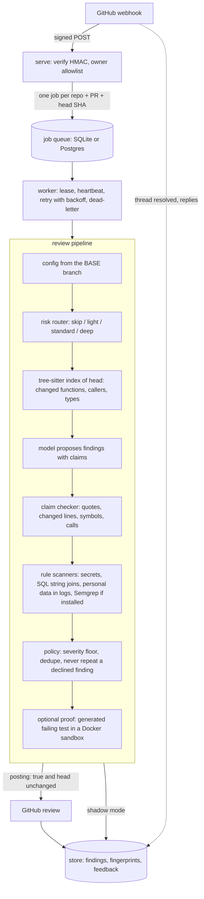

# Reviewhound

[](https://github.com/shubhamattri/reviewhound/actions/workflows/ci.yml)

Reviewhound reviews GitHub pull requests with an LLM, but it does not post what the model says
on trust. The model must back every finding with claims that code can check: the quoted line
exists, it is on a line the PR changed, the functions and types it names exist in the head
commit, a call it says is missing really is missing. One false claim drops the finding. The
failure this targets is confident comments about helpers, lines and guards that are not there: a
reviewer that makes them gets ignored, and then its real findings are ignored too. Every change
to the prompt or the checker is measured against a replay set for precision and recall.

## Results

| Eval (36 cases, 30 planted bugs) | Precision | Recall | Notes |
|---|---|---|---|
| Replayed model answers, checker on | 1.00 | 1.00 (30 of 30) | checker drops 34 false findings |
| Replayed model answers, checker off | 0.52 | 1.00 | 28 false findings get through |
| Live model, checker on (2026-10-24, commit `ee526ac`) | 1.00 | 0.97 (29 of 30) | about $0.018 per PR |

Read these with care:

- **The cases were written by the author**, who also tuned the checker. They are small PRs in
  Python, TypeScript, JavaScript, Go and one Ruby file: 29 with seeded bugs and 7 where the right
  answer is no finding. This is a regression set, not an independent benchmark.
- **The replayed rows measure the checker and policy only.** The recorded model answers include
  deliberate hallucinations (invented helpers, member names that do not exist, quotes that are
  not in the file, bugs in unchanged code, false "missing guard" claims). The first two rows are
  `uv run reviewhound eval` and `uv run reviewhound eval --no-checker` on the current commit; you
  can reproduce them offline in a few seconds.
- **The live row** asked the real model through `claude -p`. The miss was a JavaScript loop that
  skips its first row. The cost is the CLI's reported `total_cost_usd` averaged over the 36
  cases. The two proof cases were skipped: they use the local runner, and a live run only allows
  the Docker runner. Recall ranged from 0.86 to 1.00 across live runs during development, as
  the checker changed; those earlier runs are not kept in the repo. Raw output:
  [`docs/evals/live-2026-10-24-ee526ac.txt`](docs/evals/live-2026-10-24-ee526ac.txt).

## Quickstart

Needs [uv](https://docs.astral.sh/uv/) (it fetches Python 3.12 if you do not have it).

```bash
git clone https://github.com/shubhamattri/reviewhound.git
cd reviewhound
uv sync
uv run pytest -q                      # no network needed
uv run reviewhound eval               # replay recorded answers: precision and recall
uv run reviewhound eval --no-checker  # the same with the claim checker switched off
```

Reviewing a real PR needs the [`claude` CLI](https://docs.anthropic.com/en/docs/claude-code)
logged in, and a GitHub token from `GITHUB_TOKEN` or `gh`:

```bash
uv run reviewhound eval --live                                # the eval against the real model
uv run reviewhound review owner/repo 12 --dry-run             # print the review it would post
```

As a service (see [Install as a GitHub App](#install-as-a-github-app) and
[docs/deploy.md](docs/deploy.md)):

```bash
REVIEWHOUND_WEBHOOK_SECRET=... uv run reviewhound serve --port 8787
uv run reviewhound worker
uv run reviewhound enqueue owner/repo 12      # manual or missed-PR sweep
uv run reviewhound stats                      # reviews, cost, failures, backlog
```

## Architecture



The code is in `src/reviewhound/`: `webhook.py`, `queue.py`, `worker.py`, `pipeline.py`,
`router.py`, `index/`, `providers.py`, `checker.py`, `scanners.py`, `policy.py`, `proof.py`,
`poster.py`, `store.py`, with Postgres adapters in `backends/` and GitHub in `vcs/`.

## Design decisions

**The model proposes, code verifies.** A finding is JSON with a file, a line, an evidence
quote and a list of claims (`quote`, `symbol_exists`, `calls`, `not_calls`). The checker finds
the quote in the head commit (or in the lines the PR deleted), anchors the finding on a changed
line, and tests each claim against the diff and the tree-sitter index. A false claim drops the
finding, and so does a quote that cannot be found. A finding with no quote, or with a claim the
checker cannot decide, is marked unverified and by default not posted. The cost is recall: a
real bug the model cannot back with checkable evidence is held back. The eval shows what the
checker buys on the replay set (precision 0.52 without it, 1.00 with it).

**A queue between the webhook and the review.** A review takes from seconds to minutes, and
GitHub expects a webhook answer within 10 seconds, so `serve` only verifies the signature and
writes a job. The job key is repo + PR + head SHA, so redeliveries are ignored, and a newer push
supersedes jobs for that PR that are still queued (a review already running finishes). Workers
take a lease with a heartbeat. A failed job is retried with backoff and dead-lettered with its
error once it runs out of attempts; a worker that dies leaves its lease to expire, and the job is
picked up again (or dead-lettered if that was its last attempt). Posting
is guarded so a retry never posts twice: a claim on the head, a check of the lease and head
right before the POST, and a check of GitHub for a review that already landed. SQLite is enough
for one machine; Postgres lets several workers share the queue.

**Proofs run in a sandbox, and never decide anything.** For a blocking Python finding the model
can be asked for a pytest that should fail on the PR head. A test that fails as claimed is
stronger evidence for a human than a paragraph. But it runs code from the pull request, so it is
off by default, runs in Docker with no network, a read-only root, dropped capabilities and
memory, CPU and process limits, and its result can label a comment but never changes the verdict
(PR code in the same sandbox could fake the report). Details below.

**The PR cannot change how it is reviewed.** `.reviewhound.yml` is read from the base branch,
unknown keys fail loudly, and a new repo runs in shadow mode (stores findings, posts nothing)
until its config says `posting: true`. Nothing team-specific is hard-coded in the engine.

**The model gets a clean, small environment.** `claude -p` runs in an empty directory with only
local settings, and its process gets `PATH`, `HOME`, `USER`, `LOGNAME`, `LANG`, `TMPDIR`,
`SHELL`, `CLAUDE_CODE_OAUTH_TOKEN` and `CLAUDE_CONFIG_DIR`: never `ANTHROPIC_API_KEY`,
`GITHUB_TOKEN`, the database URL or the webhook secret. `git` and `semgrep` get `PATH`, `HOME`,
`LANG`, the proxy variables and the CA bundle variables.

## Testing

- `uv run pytest -q`: 650 tests, no network; model calls go through `FakeProvider`. Another 190
  run the same queue and store tests against Postgres when `REVIEWHOUND_TEST_PG=postgresql://...`
  is set, and are skipped otherwise.
- `uv run ruff check src tests evals qa` and `uv run mypy` (strict).
- `uv run reviewhound eval`: the replay set above. CI runs all four on every push to `main`
  and every pull request.
- `qa/github_qa.py`: an end-to-end run against a sandbox repo. It opens a PR with planted bugs,
  lets Reviewhound post a real review, checks through the API that every planted bug got a
  comment and nothing else did, then opens the PR in Playwright and records a video. It needs a
  sandbox repo and a GitHub login, so it is not part of CI.

## Config (`.reviewhound.yml`, all optional)

```yaml
posting: false            # shadow mode until true
languages: [python, typescript, javascript, go]
ignore_paths: ["**/*.lock", "**/dist/**"]
risk_paths:
  - {pattern: "**/billing/**", tier: deep}
  - {pattern: "docs/**", tier: light}
auth:
  guard_functions: [require_role]
personal_data_terms: [email, phone, dob]
tone_examples: ["Short and direct. Say what breaks and for whom."]
policy:
  min_severity_to_post: minor
  max_comments: 10
  blocking_severity: blocker
  drop_unverified: true
budget:
  context_bytes_standard: 60000
proof:                    # runs PR code: read "Proof by failing test" first
  enabled: false
  min_severity: blocker
  runner: docker          # docker | local (local also needs --allow-local-proof-repo)
  timeout_s: 60
  max_findings: 3
  downgrade_unproven: false
```

Unknown keys or bad values fail the review loudly instead of being guessed.

## Proof by failing test (opt-in, runs PR code)

For each posted finding that is verified, at or above `proof.min_severity`, in a Python file and
from the model (not a scanner), Reviewhound asks the model for one pytest file that asserts the
correct behaviour, writes the PR head plus that test into a fresh temp dir and runs it. The
result is read from pytest's `--junitxml` report, never from its console text:

- **proven**: every test failed with `AssertionError`, or with the exception the model said the
  bug raises. Import, syntax, collection and fixture errors never count.
- **not_proven**: the test passed. With `downgrade_unproven: true` a not-proven blocker becomes
  major (and is held if that is below `min_severity_to_post`), but the verdict does not change.
- **inconclusive**: anything else, including a timeout, a malformed model answer, Docker not
  running, or a runner crash. Severity is never changed.

A proven finding's comment says "Reproduced by a generated test" and carries the test in a
collapsed `<details>` block. A proof problem never fails the review. All proofs in one review
share a time budget (`--max-proof-seconds`, default 300) that counts the Docker runner's own
worst case (115 s with the default start grace) on top of each test's timeout, so a budget under
about 116 s runs no Docker proof.

**Threat model.** The generated test runs in the same sandbox as the PR's code, and that code
(a `conftest.py`, a `sitecustomize.py`, an import side effect) can rewrite the report or make
any assertion pass or fail. A proof result is evidence for a human, never a security decision:
it never dismisses a review, never turns REQUEST_CHANGES into COMMENT and never removes a
finding from the verdict.

- `runner: docker` (default) starts `reviewhound-proof:latest` (build it from
  `Dockerfile.proof`; it is never pulled) as user 65534 with `--network none --read-only
  --memory 512m --cpus 1 --pids-limit 128 --cap-drop ALL --security-opt no-new-privileges`. The
  tree is mounted read-only and copied into a tmpfs `/tmp`; the report is read back from a
  size-limited tmpfs through `docker exec` and never touches a host path. If the Docker daemon is
  not reachable the proof is inconclusive.
- `runner: local` is a plain subprocess with an allowlisted environment and resource limits. It
  is **not a sandbox**. A repo's config cannot enable it: the operator names each allowed repo
  with `--allow-local-proof-repo owner/name`.
- With `downgrade_unproven: true`, PR code can influence a finding's label and whether its
  comment is posted, though never the verdict. Keep it off for repos with untrusted authors.

## Evals

`evals/build_cases.py` writes `evals/cases/*`. Each case has base and head files, the expected
findings, and a recorded model answer. Two cases put the bug on a line the PR deleted, and one
has two secrets on identically shaped lines. Cases 33 and 34 turn proof on with the local runner
and recorded tests: 33 must be proven; 34 is a false blocker whose test passes, so it is
downgraded and held.

A few bugs can fairly be flagged on more than one line, so an expected finding may list `also`
anchors. A report on any of them counts, and each expected finding matches once only, so
reporting both anchors gives one true positive and one false alarm. Cases 24 (Go response body
not closed), 29 (Python role check removed) and 32 (Go deferred unlock removed) use it.

## Install as a GitHub App

Running as an App means each repo is reviewed with a short-lived installation token instead of
one person's token, and resolved threads and replies on GitHub flow back as feedback.

1. Create the App at *Settings > Developer settings > GitHub Apps*, or start from
   [`app-manifest.json`](app-manifest.json) (set your webhook URL first).
   - Permissions: **Pull requests: read and write**, **Contents: read**, **Metadata: read**.
   - Events: **`pull_request`**, **`pull_request_review_thread`**,
     **`pull_request_review_comment`**.
   - Webhook URL: `https://<your host>/webhook`, with a webhook secret.
2. Generate a private key and save the `.pem` file where the worker can read it.
3. Install the App on the repos to review.
4. Run both processes with these variables:

| Variable | Used by | What it is |
|---|---|---|
| `REVIEWHOUND_WEBHOOK_SECRET` | `serve` | The App's webhook secret. Required. |
| `REVIEWHOUND_APP_ID` | `serve`, `worker` | The App id. `serve` uses it to ignore the App's own replies. |
| `REVIEWHOUND_APP_PRIVATE_KEY_PATH` | `worker` | Path to the App's private key (`.pem`). |
| `REVIEWHOUND_ALLOWED_OWNERS` | `serve` | Comma-separated repo owners to accept events for; others get a 202 "ignored" and no job. Unset accepts every owner (with a warning). **Set it.** |
| `REVIEWHOUND_METRICS_TOKEN` | `serve` | `/metrics` then needs `Authorization: Bearer <token>`. Unset leaves it open (with a warning). **Set it.** |
| `GITHUB_TOKEN` | `enqueue` | Reads the PR head for a manual `enqueue`. The worker does not use it in App mode. |

```bash
REVIEWHOUND_WEBHOOK_SECRET=... REVIEWHOUND_APP_ID=123456 uv run reviewhound serve --port 8787
REVIEWHOUND_APP_ID=123456 REVIEWHOUND_APP_PRIVATE_KEY_PATH=~/reviewhound.pem uv run reviewhound worker
```

What the App does with events: `pull_request` (opened, synchronize, reopened, ready for review;
drafts are skipped) queues a review for the new head; resolving a review thread records the
finding as `resolved` so it is not posted again; a reply to one of its comments is stored as
feedback; when every blocker of an earlier "changes requested" review is gone from the new head,
that review is dismissed. The webhook only writes to the local database and never calls GitHub.
How each posting outcome maps to the job state is in
[docs/deploy.md](docs/deploy.md#how-a-posting-job-ends).

## Limitations and roadmap

- **Small, author-built eval set.** 36 cases is enough to catch regressions in the checker, not
  to claim accuracy on real code. Next: add real public PRs with known review outcomes.
- **Proofs are Python only.** TypeScript would need a vitest or jest runner behind the same
  interface.
- **One model backend.** Model calls go through the `claude` CLI; the provider interface has a
  registry, fallback and circuit breaker, but only that provider and a fake one exist.
- **GitHub only.** The VCS layer is an interface (`vcs/base.py`) with GitHub and in-memory
  implementations.
- **Dismissal is narrow.** A removed-guard blocker counts as fixed only when the same deleted
  lines come back in the same file; an equivalent fix written differently keeps the old verdict.
- **Posting edge cases.** A POST that times out is recorded as uncertain and retried after
  checking GitHub, which can take up to one queue lease (30 minutes by default). If GitHub
  accepted a review but does not list it yet, or a worker freezes for longer than a lease right
  before its POST, a second review could be posted. When the token cannot say which account it
  is, no existing review is adopted, so a crash right after a POST can lead to a duplicate
  rather than a silenced review. Each `claim-busy` retry uses up an attempt, so with a very short
  lease a job can end up dead.
- **Adopted or recovered reviews use this run's answer.** The verdict, id and comments come from
  GitHub, but the blockers and finding list come from this run's model answer; a comment that
  matches none of them stays unlinked, so replies to it are ignored. If saving the post id and
  saving the review both fail, the next run adopts the review from GitHub, which needs a VCS
  that can list reviews.
- **Dismissal evidence has blind spots.** A blocker whose quote only survives in an ignored or
  non-indexed file, or past the 5,000-file index cap, counts as gone.
- **Webhook.** Header bytes trickled slowly can still hold a webhook thread (the body has a 30 s
  total deadline; headers only have the 10 s per-read timeout). A resolve event redelivered byte
  for byte after an unresolve of the same thread is treated as already applied.

See [CONTRIBUTING.md](CONTRIBUTING.md) and [SECURITY.md](SECURITY.md). Licensed under Apache-2.0.
